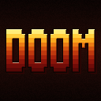

# Moybyte GPL carts

GPL-licensed carts for [Moybyte](https://github.com/moybyte-org/moybyte)
consoles. They live here, apart from the firmware, because of their licence.
They're free, and never come preinstalled on a console.

## Install

With [moy](https://github.com/moybyte-org/moy-spec/releases/tag/player-latest):

```
moy install --index https://moybyte-org.github.io/gpl-carts/index.json --list
moy install --index https://moybyte-org.github.io/gpl-carts/index.json doom /path/to/sdcard/moybyte/carts
```

From a checkout of this repository, `python3 install.py doom /path/to/sdcard/moybyte/carts`
does the same (it runs moy's installer with this index). The installer
downloads the cart, checks every file against its hash, and writes a ready
cart folder. If a cart needs extra files, it shows you their
licence and asks before downloading them. For a board without an SD card,
install to a folder on your computer and copy the cart over with Moybyte's
`tools/push_cart.py`.

## Carts

| | cart | notes |
|---|---|---|
|  | [Doom](carts/doom/) | The shareware episode. Needs about 3.3 MB of free PSRAM, so some boards run it and others show a notice. |

Each picture is the cart's `cover.png`, the one a console's store and shelf
show (moy-spec's SPEC.md 3.6). Doom's is lettering drawn by
[`carts/doom/cover.py`](carts/doom/cover.py), not a frame of the game: every
frame shows the WAD's art, which is id Software's and never hosted here.

Doom's game data (`doom1.wad`) belongs to id Software. Its licence allows
giving copies away, but not selling or modifying them, so it isn't hosted
here. The installer downloads it from Debian's archive.

## Credits

Doom is id Software's. This port is built on ozkl's
[doomgeneric](https://github.com/ozkl/doomgeneric).

## Source and licence

This repository is GPL-2.0 ([LICENSE](LICENSE)), and each cart's licence is
in its `NOTICE`. Every release includes its complete source as one archive.
Only maintainers can sign a release, but anyone can check one against its
source, from a checkout of the commit it was built from (the index's
`build.commit`):

```
python3 scripts/build.py doom --verify-release doom.moy.zip doom-v3-source.tar.gz
```

Built a cart yourself? Your build is unsigned, so turn on Unknown sources in
the console's Settings to run it.
